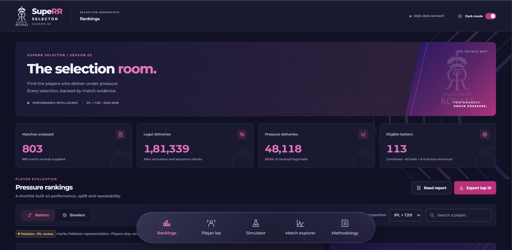

# SupeRR Selector

**A local cricket dashboard that explains its top 10 batters and top 10 bowlers under pressure.**

Built for the SupeRR Selector Season 2 challenge. Explore evidence-based player rankings, usual-versus-pressure performance, match timelines, sensitivity checks and a reproducible methodology report.



## Deployed Webpage

https://superr-selector-eight.vercel.app/#rankings

## Run in VS Code

1. Open this `RR` folder in VS Code: **File → Open Folder**.
2. Open **Terminal → New Terminal**.
3. Run:

```powershell
python app.py
```

The dashboard opens at **http://127.0.0.1:8501**. Keep the terminal running. Press **Ctrl+C** to stop.

If Windows does not recognise `python`, try:

```powershell
py -3 app.py
```

Python **3.10 or newer** is required. The project uses only Python's standard library and plain HTML/CSS/JavaScript. **No pip install, Node.js, database, API key or account is needed.** All charts, fonts and application assets work locally without an external CDN.

If Python is not installed, install it from https://www.python.org/downloads/ and enable “Add python.exe to PATH”, then restart VS Code. Do not open `web/index.html` by double-clicking it: use the local server so browser data requests work.

If port 8501 is occupied:

```powershell
python app.py --port 8502
```

The included VS Code launch configuration also supports **Run and Debug → Run SupeRR Selector**, with the Microsoft Python extension installed.

## What is included

- **Rankings:** two ordered top-10 lists, separate batting/bowling categories, Combined/IPL/T20I scopes, search, all eligible players, CSV export and player explanations.
- **Player lab:** pressure versus ordinary rates, peer expectations, component scores, match evidence, season consistency, phase distribution and five alternative-ranking scenarios.
- **Match explorer:** all retained matches, calendar-year and innings filters, interactive over-by-over pressure chart, and delivery-level explanations.
- **Methodology:** exact rules, sample-size gates, source quality checks, exclusions and an excluded-player search.
- **Report:** complete report with both top-10 lists and evidence for all 20 selections. Open **Read report → Print / Save as PDF** to create the document for upload.
- **Tests:** standard-library unit tests and source-output consistency checks.

## Important interpretation

The supplied `extras1_runs` field is a type code, despite its name. It is `6` on ordinary deliveries, `2` on wides and `4` on byes. Summing it as runs would produce incorrect team totals. `extras_2_runs` is also undocumented.

This project therefore uses a **phase-and-wicket pressure proxy** and **legal-ball bat-run metrics**. It does not claim exact chase difficulty, official batting strike rate or official bowling economy. Read the limitations before using the rankings in the competition. They rank performance relative to context and a player's baseline; they are not a generic list of the world's best players or a predicted XI.

The supplied pack's player names and dates are used as-is, without external verification. All-rounders can appear in either or both role lists. The same player is never repeated within a list.

## Rebuild from raw data

The ready-to-run dashboard includes precomputed analysis. To reproduce or modify the model, place the six supplied CSVs in `data/raw/` (they are already copied there in the local project):

```text
ball_by_ball.csv
competition_team_player_mapping.csv
competitions.csv
matches.csv
playing_eleven.csv
teams.csv
```

Run from the project root:

```powershell
python -m analysis.build --data-dir data/raw
python -m unittest discover -s tests -v
python app.py
```

No internet connection is needed. The builder creates dashboard data, match detail files, CSV rankings, the source audit and the methodology report. Refresh the browser after rebuilding.

The model settings are near the top of `analysis/build.py`. If changing rules, also update the methodology template and UI explanation before regenerating outputs. The application currently presents the version 1 default rules (threshold 55, 60-ball gates, 8-match gate, 50/30/20 weights).

## Validation

The included dataset passed all 15 automated checks. Browser checks covered category switching, competition filtering, player profiles, player search, CSV download, innings/over selection, the methodology audit and the printable report. Desktop and phone-sized layouts were visually inspected, including a horizontal-overflow check on the phone layout. No browser console errors were observed during those checks. See `docs/VALIDATION.md` for the scope and remaining limits.

## Project structure

```text
RR/
  app.py                         Local web server and browser launcher
  analysis/build.py              Cleaning, pressure, context and ranking pipeline
  data/raw/                      Original CSVs (ignored by Git)
  docs/methodology_template.md    Source text for the generated report
  reports/
    METHODOLOGY.md                Full generated submission report
    top_10_batters.csv            Final Combined batting list
    top_10_bowlers.csv            Final Combined bowling list
    data_audit.json               Counts, assumptions and source hashes
  tests/test_analysis.py          Calculation and output checks
  web/
    index.html                   Dashboard
    styles.css                   Responsive visual design
    app.js                       Filters, charts, player views and exports
    report.html                  Printable report
    report.js                    Safe report renderer
    data/                        Generated data, including per-match evidence
  .vscode/launch.json             VS Code run configuration
```

## Before submitting

1. Review the **Combined** top-10 lists and individual player caveats. IPL/T20I lists are exploratory.
2. Open the printable report and save it as PDF. Check page layout and the rankings in your saved PDF.
3. Enter the same two ordered lists into the Unstop dropdowns. The challenge requires those selections plus the report; a dashboard URL alone is not the submission.
4. Keep the scoring definition and sample-size limitations visible in your explanation.

## Model summary

Pressure is calculated **before** the current delivery. Death overs, previous wicket losses, wicket clusters and knockout stage add pressure points. Candidates require 60 pressure balls, 60 ordinary balls and 8 pressure matches with 6+ balls each. Context-adjusted impact combines scoring/run prevention (65%) and survival/wicket taking (35%). The final relative rating combines pressure performance (50%), baseline uplift (30%) and repeatability (20%), with shrinkage and eligibility safeguards.

Rank sensitivity is evaluated under thresholds 50 and 65, weights 60/20/20 and 40/40/20, and removal of each player's highest-total-impact pressure match. Scenario rank ranges are not statistical confidence intervals. Exact formulas and limitations are in `reports/METHODOLOGY.md`.


## Scenario lab and scouting maps

The **Simulator** tab runs 2,000 reproducible, conditional finishes for a chosen batter and bowler. Set the runs needed/required rate, whole overs remaining, wickets and bowling quota; optionally enter a scoring-only strike-rate assumption. Save a baseline, change a setting and compare the results, or export the scenario. The outputs are bat-runs-only illustrations, not calibrated match win probabilities.

Player Lab now includes off-side/leg-side field summaries, bowling-style or batting-hand matchups, delivery variations, shot labels and head-to-head evidence, with phase filtering and visible sample sizes. These maps summarize supplied side tags, not precise tracked shot angles.

See [the scenario and scouting guide](docs/SCENARIO_GUIDE.md) for the model, limitations, internet references and verification commands. This guide supplements the earlier PDF. For professional use, verified scoring/shot feeds and out-of-sample calibration are still needed.

## Expanded player lab

The player lab now shows sourced portraits, country/representation, dated roster and activity evidence, sample averages and strike rates, and eight recent appearances with pressure-situation filters. Pakistan representation is marked for individual IPL availability review without changing ratings. See [the player-lab notes](docs/PLAYER_LAB.md) for source coverage and refresh instructions.

The full 19-page project guide is [available as a PDF](output/pdf/SupeRR_Selector_Project_Guide.pdf), and can also be downloaded from the dashboard footer or report page.
